# agentic

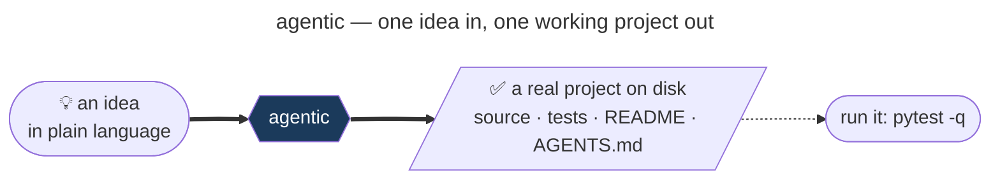

---

## 1. What it is

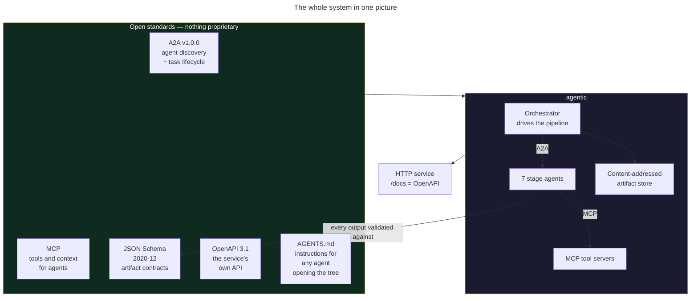

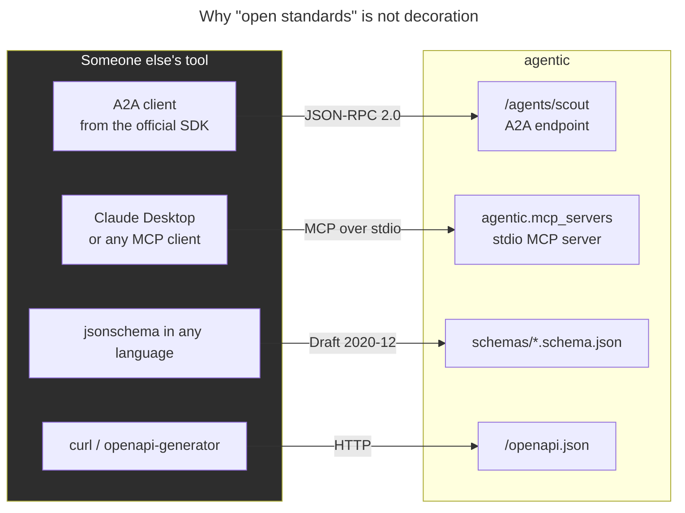

---

## 2. How to use it

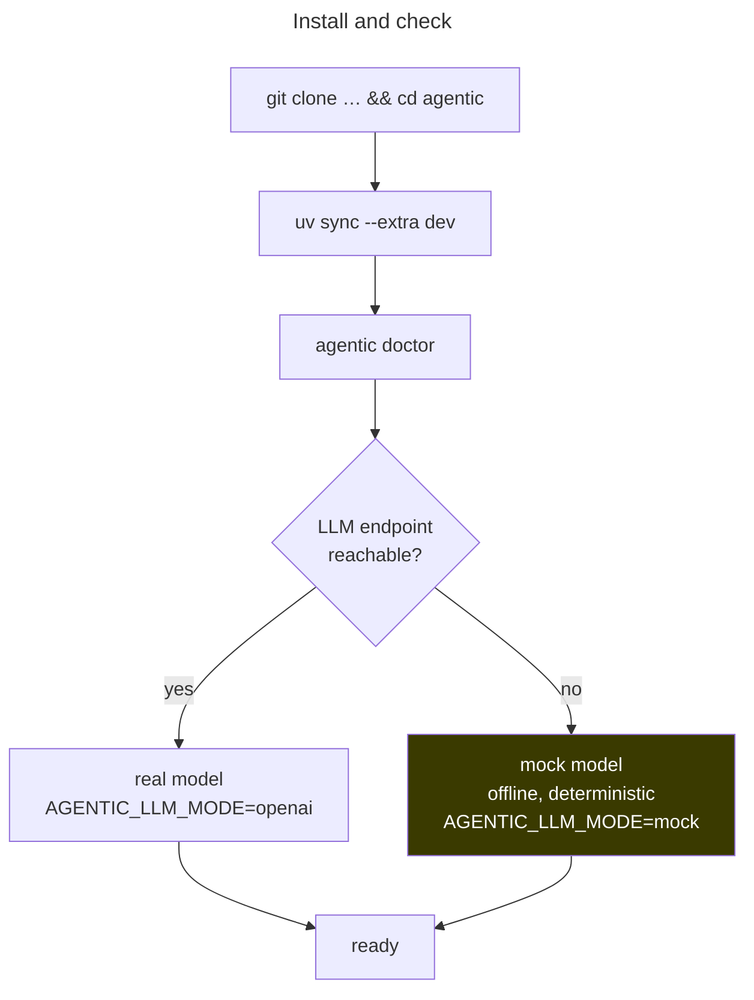

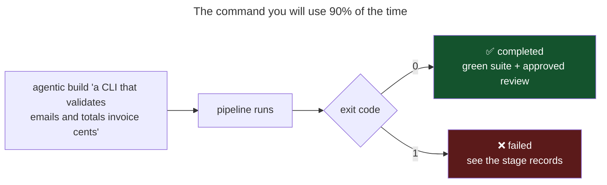

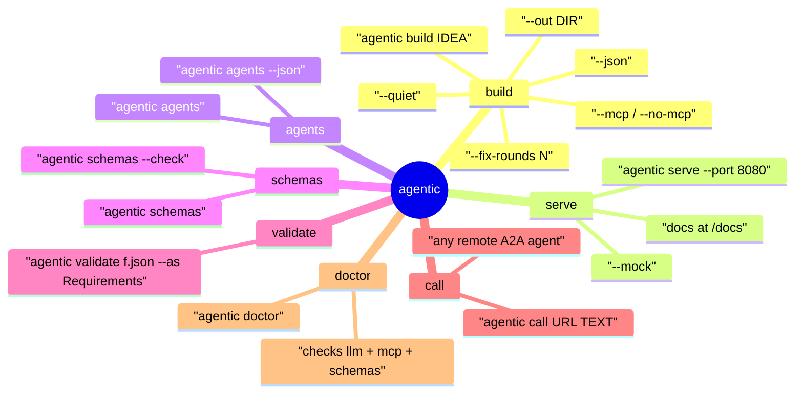

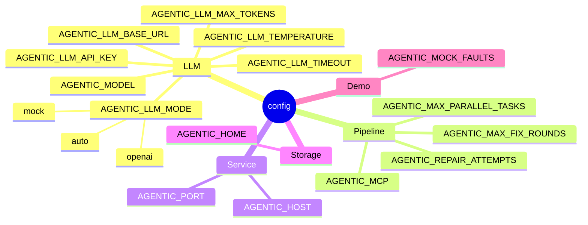

---

## 3. The pipeline

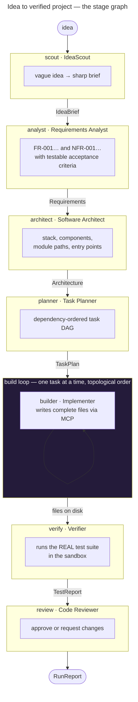

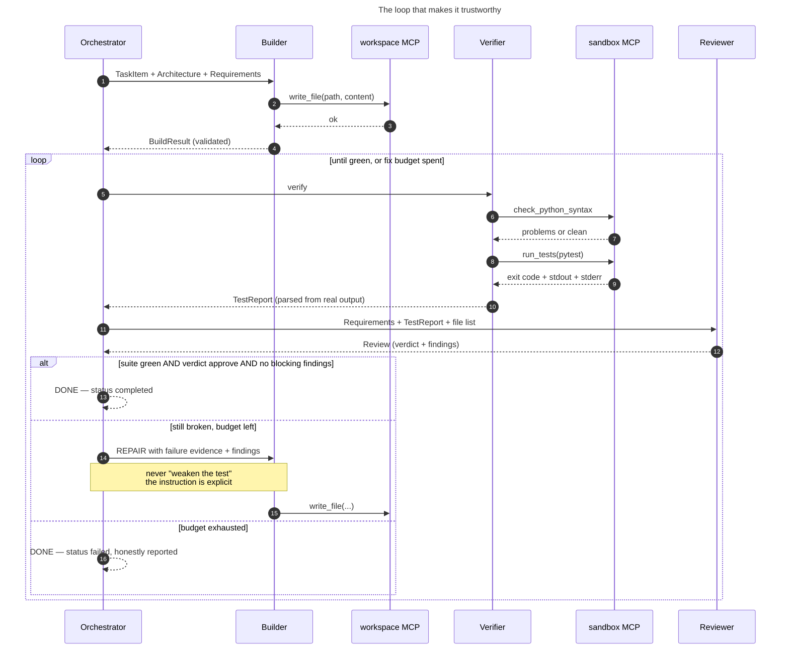

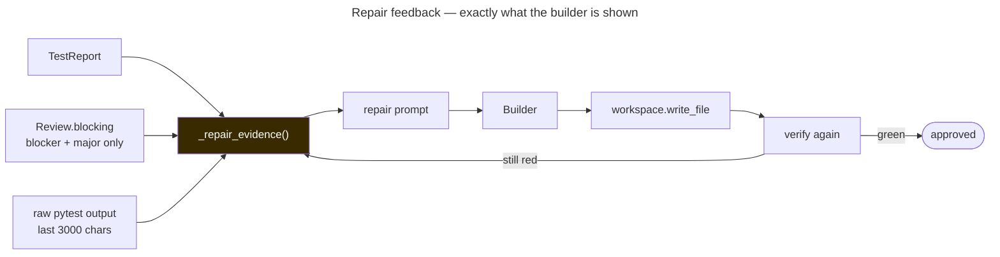

---

## 4. The agents

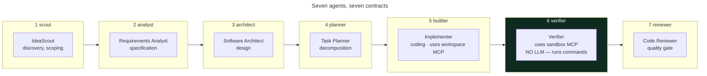

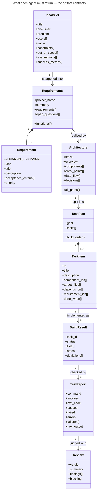

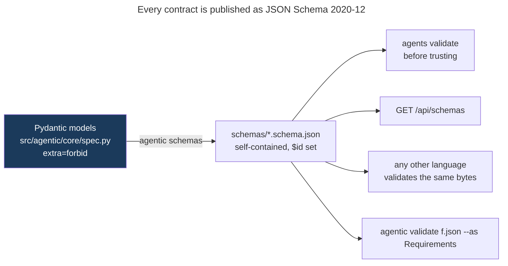

---

## 5. Schema-constrained generation

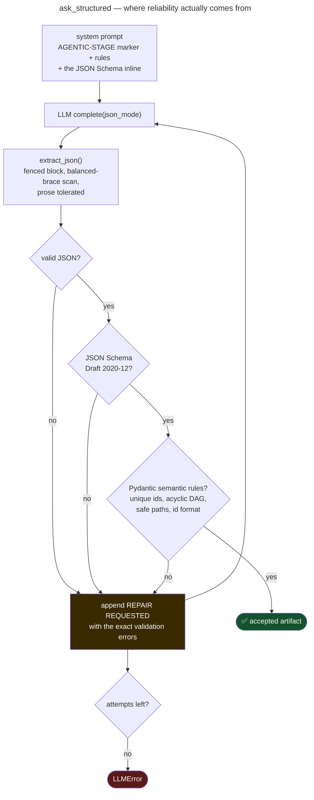

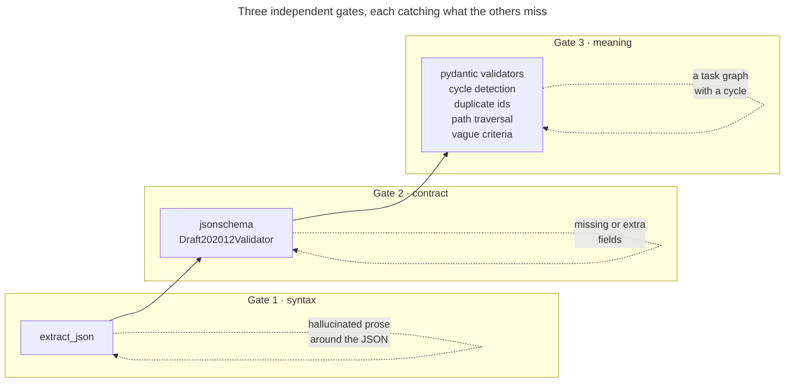

---

## 6. A2A — how agents talk

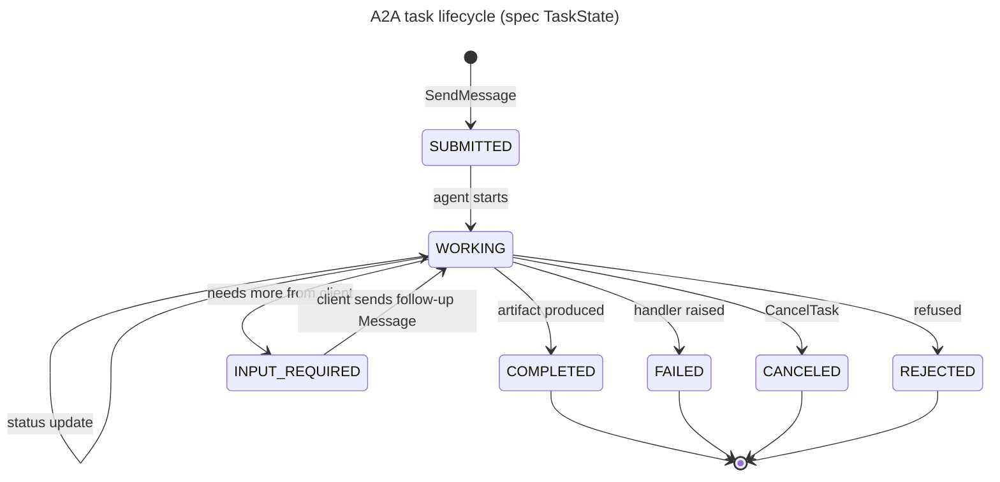

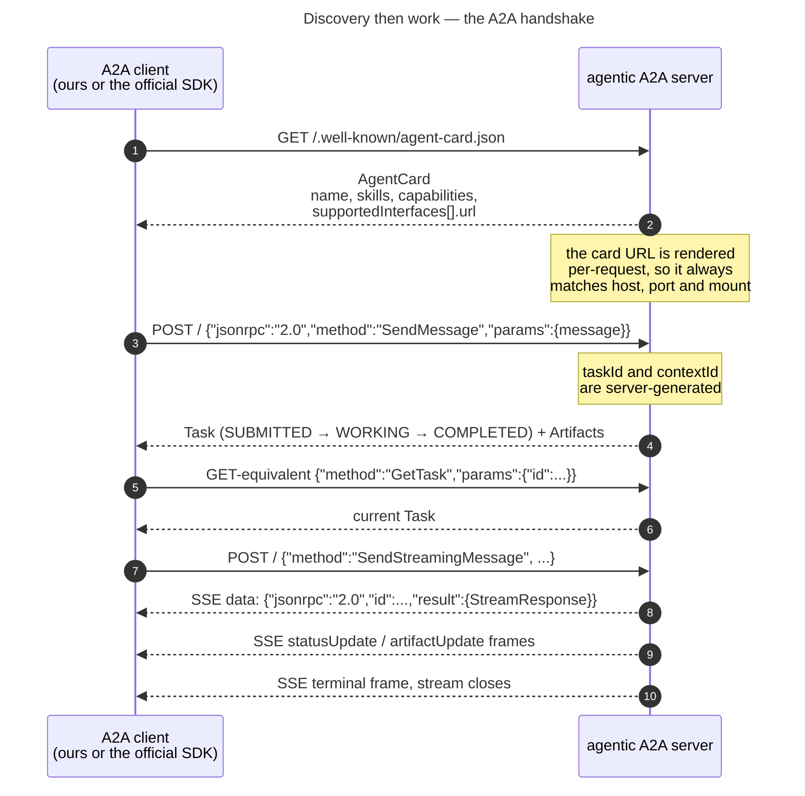

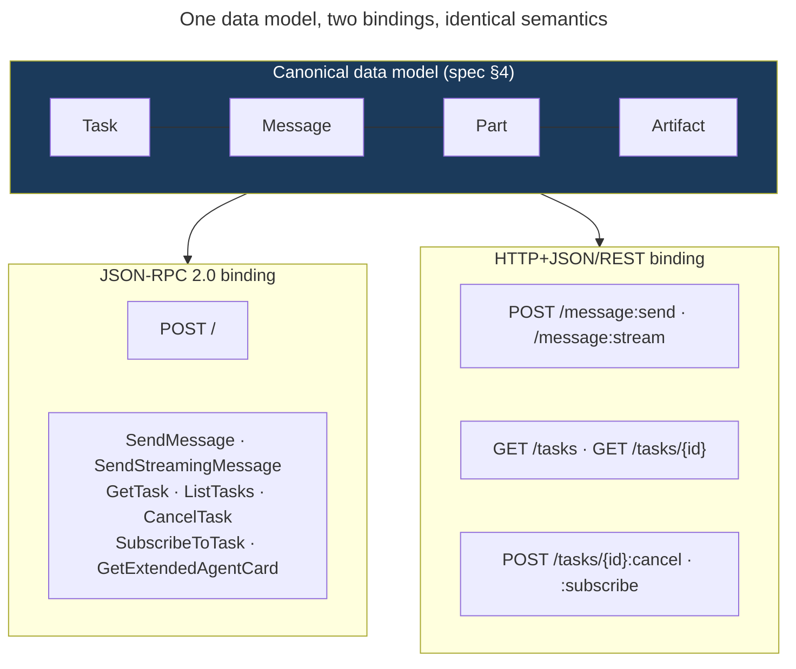

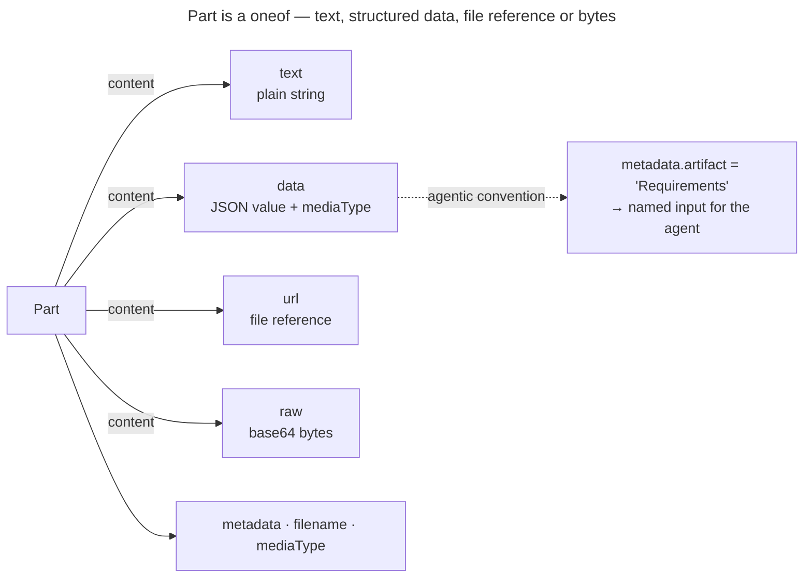

```mermaid
---
title: Error codes are the spec's, not invented
---
flowchart LR
    subgraph E["A2A error → JSON-RPC code → HTTP status"]
        direction TB
        E1["TaskNotFoundError · -32001 · 404"]
        E2["TaskNotCancelableError · -32002 · 400"]
        E3["PushNotificationNotSupported · -32003 · 400"]
        E4["UnsupportedOperation · -32004 · 400"]
        E5["ContentTypeNotSupported · -32005 · 400"]
        E6["InvalidAgentResponse · -32006 · 500"]
        E7["VersionNotSupported · -32009 · 400"]
        E8["MethodNotFound · -32601 · 404"]
        E9["InvalidParams · -32602 · 400"]
    end
    E --> N["JSON-RPC carries errors in the envelope<br/>with HTTP 200; the REST binding uses the HTTP status"]
```

---

## 7. MCP — how agents act

```mermaid
---
title: Agents never touch your disk or shell directly
---
flowchart LR
    subgraph AG["Agent"]
        A["Builder / Verifier"]
    end
    subgraph TB["MCPToolbox"]
        T["spawns stdio servers<br/>owns sessions<br/>normalises results"]
    end
    subgraph SRV["MCP servers (real MCP, over stdio)"]
        W["agentic-workspace<br/>list_files · read_file<br/>write_file · delete_file"]
        S["agentic-sandbox<br/>run_command · run_tests<br/>check_python_syntax"]
        AR["agentic-artifacts<br/>read_artifact · write_artifact"]
    end
    A --> T --> SRV
    SRV --> FS[("project directory")]
    SRV --> PR[("subprocess<br/>pytest")]
    style AG fill:#241b3a,color:#fff
    style SRV fill:#0f2a1f,color:#fff
```

```mermaid
---
title: An MCP tool call, byte for byte
---
sequenceDiagram
    autonumber
    participant A as Agent
    participant X as MCPToolbox
    participant C as ClientSession
    participant P as python -m agentic.mcp_servers
    participant S as MCPServer

    X->>P: spawn subprocess, stdin/stdout pipes
    X->>C: wrap pipes
    C->>S: initialize
    S-->>C: capabilities + server info
    C->>S: list_tools
    S-->>C: tool list with JSON Schemas
    A->>X: call("workspace","write_file",{path,content})
    X->>C: call_tool
    C->>S: tools/call
    S->>S: _safe_join(root, path)<br/>reject .. and absolute paths
    S-->>C: CallToolResult structuredContent
    C-->>A: {"ok":true,"path":"app/core.py"}
    X->>P: terminate on context exit
```

```mermaid
---
title: Policy enforced by the servers, not by trusting the model
---
flowchart TD
    A["tool call arrives"] --> B{"path relative,<br/>no .. no ~ no /"}
    B -->|no| X1["reject: path escapes workspace root"]
    B -->|yes| C{"resolved path<br/>inside root?"}
    C -->|no| X1
    C -->|yes| D{"server read-only?"}
    D -->|yes| X2["reject: read-only"]
    D -->|no| OK(["perform the action"])

    E["run_command arrives"] --> F{"contains ; & | backtick $ newline"}
    F -->|yes| Y1["reject: shell metacharacters"]
    F -->|no| G{"executable on allowlist?"}
    G -->|no| Y1
    G -->|yes| H{"python -c or -m?"}
    H -->|yes| Y2["reject: use run_tests instead"]
    H -->|no| YOK(["exec with timeout"])
    style X1 fill:#5b1a1a,color:#fff
    style Y1 fill:#5b1a1a,color:#fff
```

```mermaid
---
title: Use the same servers from outside agentic
---
flowchart LR
    A["python -m agentic.mcp_servers workspace --root ./proj"] --> C["any MCP client"]
    B["python -m agentic.mcp_servers sandbox --root ./proj"] --> C
    C --> D["Claude Desktop"]
    C --> E["MCP Inspector"]
    C --> F["another agent framework"]
```

---

## 8. The service

```mermaid
---
title: One port, two standards-compliant surfaces
---
flowchart TB
    subgraph APP["agentic serve"]
        direction TB
        subgraph API["OpenAPI 3.1 REST — /docs"]
            H1["GET /health"]
            H2["GET /api/agents"]
            H3["GET /api/schemas"]
            H4["POST /api/runs · GET /api/runs"]
            H5["GET /api/runs/{id}"]
            H6["GET /api/runs/{id}/events  SSE"]
            H7["GET /api/runs/{id}/report"]
            H8["GET /api/a2a/cards"]
        end
        subgraph A2A["A2A per agent"]
            G1["/agents/scout/"]
            G2["/agents/analyst/"]
            G3["/agents/architect/"]
            G4["/agents/planner/"]
            G5["/agents/builder/"]
            G6["/agents/verifier/"]
            G7["/agents/reviewer/"]
        end
    end
    U1["your app"] --> API
    U2["any A2A client"] --> A2A
    style API fill:#1b3a5b,color:#fff
    style A2A fill:#241b3a,color:#fff
```

```mermaid
---
title: Drive a run over HTTP
---
sequenceDiagram
    autonumber
    participant U as Client
    participant S as Service
    participant O as Orchestrator

    U->>S: POST /api/runs {"idea":"..."}
    S->>O: build() in a background task
    S-->>U: 202 {"run_id":"run-abc","status":"running"}
    par stream progress
        U->>S: GET /api/runs/run-abc/events
        S-->>U: SSE stage events (scout, build, verify, fix ...)
    and poll
        U->>S: GET /api/runs/run-abc
        S-->>U: status
    end
    S-->>U: SSE run finished
    U->>S: GET /api/runs/run-abc/report
    S-->>U: RunReport (validated against its schema)
```

```mermaid
---
title: Calling a single agent, not the whole pipeline
---
flowchart LR
    A["agentic call http://host:8080/agents/scout 'a tool that ...'"] --> B["A2AClient<br/>reads the card"]
    B --> C["SendMessage"]
    C --> D["Task COMPLETED<br/>artifact IdeaBrief"]
    D --> E["prints the JSON artifact"]
```

---

## 9. Storage and reproducibility

```mermaid
---
title: Content-addressed artifact store
---
flowchart TD
    A["stage produces a model"] --> B["validate against JSON Schema"]
    B --> C["canonical JSON<br/>sorted keys, indent 2"]
    C --> D["sha256 digest"]
    D --> E[("runs/{run_id}/artifacts/<br/>{Name}-{digest16}.json")]
    E --> F["index.json records the uri"]
    F --> G["agentic://{run_id}/{Name}@{digest16}"]
    G --> H["same bytes → same address →<br/>a run can be replayed and audited"]
    style E fill:#1b3a5b,color:#fff
```

```mermaid
---
title: What lands on disk
---
flowchart TB
    R[(".agentic/runs/{run_id}/")] --> A["artifacts/<br/>IdeaBrief-abc123.json …"]
    R --> I["index.json"]
    R --> P["project/"]
    P --> P1["pyproject.toml"]
    P --> P2["README.md"]
    P --> P3["AGENTS.md"]
    P --> P4["{package}/core.py · cli.py · __main__.py"]
    P --> P5["tests/test_core.py"]
    style P fill:#0f2a1f,color:#fff
```

---

## 10. Offline mode and the fix-loop demo

```mermaid
---
title: Mock mode — the pipeline is testable with zero API keys
---
flowchart LR
    A["prompt"] --> B["parse AGENTIC-STAGE marker"]
    B --> C["parse <<<ARTIFACT:Name blocks"]
    C --> D{"stage"}
    D -->|scout analyst architect planner| E["deterministic<br/>parameterised JSON"]
    D -->|builder| F["real code generator<br/>codegen.py"]
    D -->|reviewer| G["verdict from the<br/>actual TestReport"]
    F --> H["19 real behaviours,<br/>each with a real test"]
    style F fill:#0f2a1f,color:#fff
```

```mermaid
---
title: Prove the loop heals — AGENTIC_MOCK_FAULTS=1
---
sequenceDiagram
    autonumber
    participant B as Builder
    participant V as Verifier
    participant O as Orchestrator

    B->>V: code with an injected off-by-one
    V->>V: pytest → 1 failed
    V-->>O: TestReport(success=false)
    O->>O: reviewer → blocker → request_changes
    O->>B: REPAIR with the failure output
    Note over B: mock regenerates correct code<br/>real model gets the real diff to fix
    B->>V: repaired code
    V-->>O: 6 passed
    O-->>O: approved, fix_rounds=1
```

---

## 11. Code map

```mermaid
---
title: Where everything lives
---
mindmap
  root((src/agentic))
    core
      spec.py
        contracts
      contracts.py
        schema gen + validate
      artifacts.py
        content addressed store
      events.py
        event bus
    llm
      base.py
        protocol
      openai_compat.py
        any OpenAI-shaped server
      mock.py
        offline deterministic
      structured.py
        repair loop
    a2a
      models.py
        ProtoJSON types
      server.py
        JSONRPC + REST + SSE
      client.py
        httpx client
    mcp_servers
      workspace.py
      sandbox.py
      artifacts_server.py
      __main__.py
    mcp
      toolbox.py
        stdio spawner
    agents
      base.py
      stages.py
      registry.py
      codegen.py
    pipeline
      graph.py
      orchestrator.py
    service
      app.py
    cli.py
```

---

## 12. How to extend it

```mermaid
---
title: Add a new artifact contract
---
flowchart LR
    A["add a Pydantic model<br/>in core/spec.py"] --> B["register it in MODELS"]
    B --> C["agentic schemas"]
    C --> D["schemas/YourThing.schema.json"]
    D --> E["agents can now be asked<br/>to produce it and it is validated"]
```

```mermaid
---
title: Add a new agent
---
flowchart LR
    A["subclass StageAgent"] --> B["set stage · output_model · requires"]
    B --> C["write system_prompt()"]
    C --> D["register in AGENT_TYPES"]
    D --> E["it appears in<br/>agentic agents<br/>/api/agents<br/>/agents/{stage} as A2A"]
    E --> F["wire it into PIPELINE in pipeline/graph.py"]
```

```mermaid
---
title: Add a new tool
---
flowchart LR
    A["add an async function<br/>under @server.tool in an MCP server"] --> B["it is auto-described<br/>from its signature"]
    B --> C["agents call it via<br/>toolbox.call(server, tool, args)"]
    C --> D["any external MCP client<br/>sees it too"]
```

---

## 13. Test strategy

```mermaid
---
title: What is proven, and how
---
flowchart TB
    subgraph T1["Contracts"]
        A["test_contracts<br/>schema gen · extra=forbid ·<br/>cycle rejection · id format"]
    end
    subgraph T2["Standards compliance"]
        B["test_a2a_wire_compat<br/>round-trip every object through<br/>the official protobuf types"]
        C["test_a2a_protocol<br/>our client vs our server<br/>over a real socket"]
        D["test_official_sdk_interop<br/>official a2a-sdk client<br/>drives our server"]
    end
    subgraph T3["Tools — planned, see TODO"]
        E["test_mcp_tools<br/>stdio spawn · traversal blocked ·<br/>allowlist enforced"]
    end
    subgraph T4["End to end — planned, see TODO"]
        F["test_pipeline_e2e<br/>full mock run green ·<br/>fault injection triggers a fix round"]
        G["test_codegen<br/>every generated CLI command runs"]
    end
    T1 --> T2 --> T3 --> T4
    style T2 fill:#0f2a1f,color:#fff
    style T3 fill:#3a3a00,color:#fff
    style T4 fill:#3a3a00,color:#fff
```

```mermaid
---
title: Interop is proven, not assumed
---
flowchart LR
    A["our JSON"] -->|"json_format.ParseDict"| B["official a2a_pb2 types"]
    B -->|"MessageToDict"| C{"byte-identical<br/>to our wire form?"}
    C -->|yes| D(["✅ canonical A2A v1.0.0"])
    C -->|no| E(["test fails — drift is caught<br/>in CI, not in production"])
    F["official a2a-sdk Client"] -->|real HTTP| G["our A2A server"]
    G --> H(["card · SendMessage ·<br/>GetTask · artifacts"])
    style D fill:#14532d,color:#fff
```

---

## 14. Design decisions

```mermaid
---
title: The choices that matter
---
flowchart TB
    subgraph D1["Verification is execution"]
        A["the Verifier runs pytest<br/>a model never reports<br/>what it thinks happened"]
    end
    subgraph D2["Contracts before trust"]
        B["no artifact is accepted until<br/>it passes JSON Schema + Pydantic"]
    end
    subgraph D3["Side effects behind MCP"]
        C["agents cannot touch disk or shell<br/>except through audited tools"]
    end
    subgraph D4["Data over control flow"]
        D["the pipeline is a table in graph.py<br/>reorder or extend without rewriting"]
    end
    subgraph D5["Boring dependencies"]
        E["pydantic · fastapi · httpx ·<br/>jsonschema · mcp · typer"]
    end
    style D1 fill:#0f2a1f,color:#fff
```

```mermaid
---
title: Failure is a first-class outcome
---
stateDiagram-v2
    [*] --> Running
    Running --> Completed : green suite + approved
    Running --> Failed : stage raised
    Running --> Failed : fix budget spent
    Failed --> [*] : RunReport still written,<br/>stage records say exactly where
    Completed --> [*]
```
